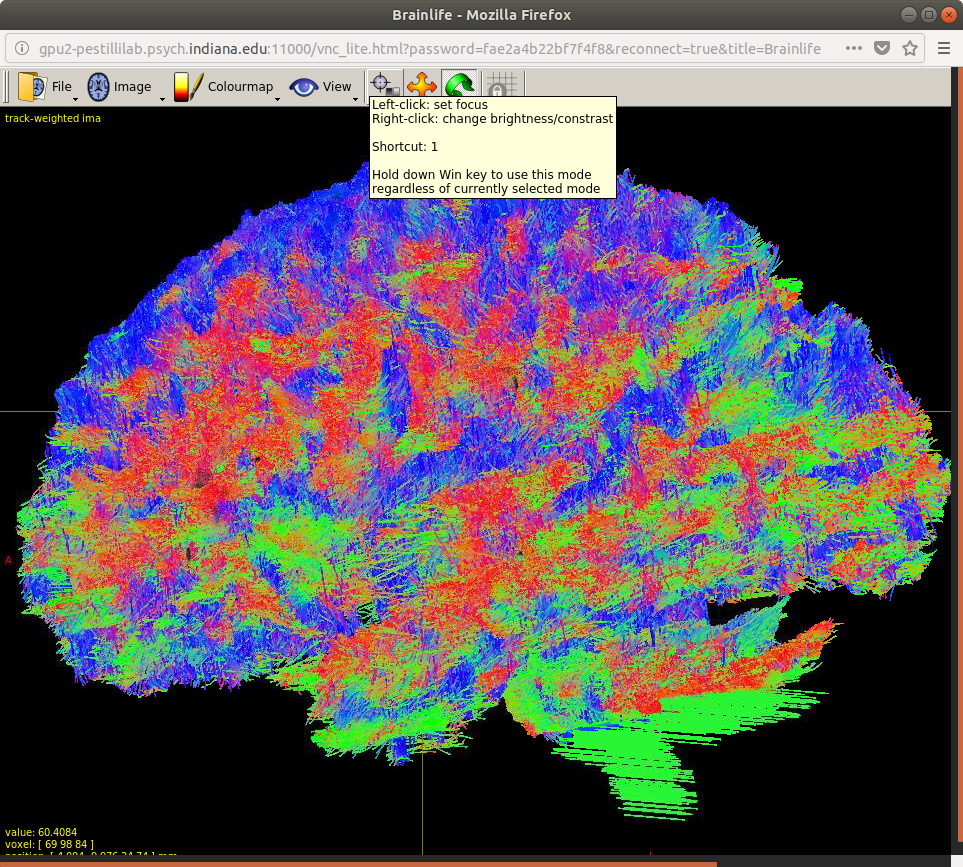

<p align="center">
  
</p>

<h1 align="center">Ensemble Tracking</h1>

<p align="center">
  A rich whole-brain candidate tractogram from diffusion data, combining tensor, CSD deterministic and CSD probabilistic tracking over several lmax and curvature values.
</p>

<p align="center">
  <a href="https://github.com/brainlife/abcd-spec"></a>
  <a href="https://doi.org/10.25663/bl.app.103"></a>
  <a href="https://github.com/brainlife/app-ensembletracking/blob/master/LICENSE"></a>
</p>

> **This branch, `1.5`, runs 2 brainlife.io Apps** that share the same code:
>
> - Ensemble Tracking (dwi) ([doi:10.25663/bl.app.103](https://doi.org/10.25663/bl.app.103))
> - Ensemble Tracking with dtiInit ([doi:10.25663/bl.app.33](https://doi.org/10.25663/bl.app.33))
>
> The other Apps in this repository are listed under **Versions on brainlife.io** below.

## At a glance

<!-- brainlife-app:begin (generated from the App manifest; edit the manifest, not this block) -->

### Ensemble Tracking (dwi)

> **Generates an ensemble whole-brain tractogram from DWI with MRtrix 0.2.12, combining tensor, CSD deterministic and CSD probabilistic tracking over several lmax and curvature values into one .tck.**

Implements Ensemble Tractography (Takemura et al. 2016): fits CSD at every even lmax up to max_lmax, tracks with DT_STREAM, SD_STREAM and SD_PROB over the chosen curvature values from white-matter and corpus-callosum seeds (plus optional optic radiation and visual tracts), and concatenates all candidates into track.tck. Use it to produce a rich candidate tractogram, for example for LiFE or COMMIT filtering. Requires a FreeSurfer run of the same subject for the masks. num_or_fibers above 25 makes the App exit.

| | |
|---|---|
| **Inputs** | `neuro/dwi` · `neuro/freesurfer` |
| **Outputs** | `neuro/track/tck` · `neuro/mask` |
| **Container** | `brainlife/freesurfer:6.0.0` |
| **Resources** | 8 CPUs · 15 GB memory · 15 h walltime |
| **Requires** | `FREESURFER_LICENSE` |
| **Run it** | [doi.org/10.25663/bl.app.103](https://doi.org/10.25663/bl.app.103) |

#### Inputs

| Input | Datatype | Required | Description |
|---|---|---|---|
| `dwi` | `neuro/dwi` | yes | Diffusion-weighted image with bvals and bvecs. |
| `freesurfer` | `neuro/freesurfer` | yes | FreeSurfer recon-all output of the same subject, used to build white-matter, corpus callosum and other seed/ROI masks. |

#### Outputs

| Output | Datatype | Description |
|---|---|---|
| `output` | `neuro/track/tck` | Ensemble tractogram (track.tck) concatenating all algorithm, lmax and curvature runs. |
| `mask_dwi` | `neuro/mask` | (despite the odd output directory name "mask_dwi") A brain mask created from freesurfer aparc+aseg converted to .nii.gz using input t1 as output template volume (--temp). It uses all white matter segments (--match 2 41 16 17 28 60 51 53 12 52 13 18 54 50 11 251 252 253 254 255 10 49 46 7) see FreeSurferColorLUT |

<details>
<summary><b>Parameters</b> (14)</summary>

| Parameter | Type | Default | Description |
|---|---|---|---|
| `stepsize` | number | `0.2` | set the step size of the tracking |
| `minlength` | number | `10` | set the minimum length of the streamlines generated |
| `maxlength` | number | `200` | set the maximum length of the streamlines generated |
| `num_or_fibers` | number | `0` | Number of streamlines to track the optic radiation (probabilistic tracking only) |
| `num_mt_fibers` | number | `0` | (temporarily disabled as this tracking gets stuck) Number of streamlines to track the cortico-spinal tract |
| `num_vz_fibers` | number | `0` | Number of streamlines to track the visual-associative tracts |
| `detr_curvs` | string | `0.25 0.5 1 2 4` | Range of curvature parameters used for deterministic tracking |
| `prob_curvs` | string | `0.25 0.5 1 2 4` | Range of curvature parameters used for probabilistic tracking |
| `num_cc_fibers` | number | `2500` | Number of streamlines to track seeding the corpus callosum |
| `num_fibers` | integer | `12500` | Total number of streamlines requested per individual streamline output file (.tck) |
| `max_lmax` | integer |  | Maximum number of parameters for the constrained spherical deconvolution. Leave it empty to auto calculate from the number of available directions in bvecs/bvals. |
| `do_tensor` | boolean | `true` | Include tensor-based deterministic tracking (DT_STREAM). |
| `do_probabilistic` | boolean | `true` | Include CSD-based probabilistic tracking (SD_PROB) at each lmax and curvature. |
| `do_deterministic` | boolean | `true` | Include CSD-based deterministic tracking (SD_STREAM) at each lmax and curvature. |

</details>

### Ensemble Tracking with dtiInit

> **Generates an ensemble whole-brain tractogram from a dtiInit output with MRtrix 0.2.12, combining tensor, CSD deterministic and CSD probabilistic tracking over several lmax and curvature values into one .tck.**

Implements Ensemble Tractography (Takemura et al. 2016): fits CSD at every even lmax up to max_lmax, tracks with DT_STREAM, SD_STREAM and SD_PROB over the chosen curvature values from white-matter and corpus-callosum seeds (plus optional optic radiation and visual tracts), and concatenates all candidates into track.tck. Use it to produce a rich candidate tractogram, for example for LiFE or COMMIT filtering. Requires a FreeSurfer run of the same subject for the masks. num_or_fibers above 25 makes the App exit.

| | |
|---|---|
| **Inputs** | `neuro/dtiinit` · `neuro/freesurfer` |
| **Outputs** | `neuro/track/tck` · `neuro/mask` |
| **Container** | `brainlife/freesurfer:6.0.0` |
| **Resources** | 8 CPUs · 15 GB memory · 15 h walltime |
| **Requires** | `FREESURFER_LICENSE` |
| **Run it** | [doi.org/10.25663/bl.app.33](https://doi.org/10.25663/bl.app.33) |

#### Inputs

| Input | Datatype | Required | Description |
|---|---|---|---|
| `dwi` | `neuro/dtiinit` | yes | dtiInit output; the aligned DWI, bvals and bvecs listed in dt6.json are tracked. |
| `freesurfer` | `neuro/freesurfer` | yes | FreeSurfer recon-all output of the same subject, used to build white-matter, corpus callosum and other seed/ROI masks. |

#### Outputs

| Output | Datatype | Description |
|---|---|---|
| `output` | `neuro/track/tck` | Ensemble tractogram (track.tck) concatenating all algorithm, lmax and curvature runs. |
| `mask_dwi` | `neuro/mask` | (despite the odd output directory name "mask_dwi") A brain mask created from freesurfer aparc+aseg converted to .nii.gz using input t1 as output template volume (--temp). It uses all white matter segments (--match 2 41 16 17 28 60 51 53 12 52 13 18 54 50 11 251 252 253 254 255 10 49 46 7) see FreeSurferColorLUT |

<details>
<summary><b>Parameters</b> (14)</summary>

| Parameter | Type | Default | Description |
|---|---|---|---|
| `stepsize` | number | `0.2` | set the step size of the tracking |
| `minlength` | number | `10` | set the minimum length of the streamlines generated |
| `maxlength` | number | `200` | set the maximum length of the streamlines generated |
| `num_or_fibers` | number | `0` | Number of streamlines to track the optic radiation (probabilistic tracking only) |
| `num_mt_fibers` | number | `0` | (temporarily disabled as this tracking gets stuck) Number of streamlines to track the cortico-spinal tract |
| `num_vz_fibers` | number | `0` | Number of streamlines to track the visual-associative tracts |
| `detr_curvs` | string | `0.25 0.5 1 2 4` | Range of curvature parameters used for deterministic tracking |
| `prob_curvs` | string | `0.25 0.5 1 2 4` | Range of curvature parameters used for probabilistic tracking |
| `num_cc_fibers` | number | `2500` | Number of streamlines to track seeding the corpus callosum |
| `num_fibers` | integer | `12500` | Total number of streamlines requested per individual streamline output file (.tck) |
| `max_lmax` | integer |  | Maximum number of parameters for the constrained spherical deconvolution. Leave it empty to auto calculate from the number of available directions in bvecs/bvals. |
| `do_tensor` | boolean | `true` | Include tensor-based deterministic tracking (DT_STREAM). |
| `do_probabilistic` | boolean | `true` | Include CSD-based probabilistic tracking (SD_PROB) at each lmax and curvature. |
| `do_deterministic` | boolean | `true` | Include CSD-based deterministic tracking (SD_STREAM) at each lmax and curvature. |

</details>

<!-- brainlife-app:end -->

## Versions on brainlife.io

Each version is a separate App on brainlife.io, built from a branch of this repository.

| App | Diffusion input | Branch | Run it | Status |
|---|---|---|---|---|
| **Ensemble Tracking (dwi)** (this branch) | `neuro/dwi` | [`1.5`](https://github.com/brainlife/app-ensembletracking/tree/1.5) | [doi:10.25663/bl.app.103](https://doi.org/10.25663/bl.app.103) | current |
| **Ensemble Tracking with dtiInit** (this branch) | `neuro/dtiinit` | [`1.5`](https://github.com/brainlife/app-ensembletracking/tree/1.5) | [doi:10.25663/bl.app.33](https://doi.org/10.25663/bl.app.33) | available |
| old ensemble tracking | `neuro/dtiinit` | [`singularity`](https://github.com/brainlife/app-ensembletracking/tree/singularity) | [doi:10.25663/brainlife.app.149](https://doi.org/10.25663/brainlife.app.149) | deprecated |

## Running the App

### On brainlife.io

Open the App at [doi.org/10.25663/bl.app.103](https://doi.org/10.25663/bl.app.103) (or [doi.org/10.25663/bl.app.33](https://doi.org/10.25663/bl.app.33) for a dtiInit input), choose the diffusion data and a FreeSurfer output of the same subject, set the options and press **Execute**. The result is a `neuro/track/tck` tractogram tagged `ensemble`, plus a white-matter `neuro/mask`, archived to your project. Use it to produce a rich candidate tractogram, for example for LiFE or COMMIT filtering.

The App implements Ensemble Tractography (Takemura et al. 2016) with MRtrix 0.2.12. It builds white-matter, corpus callosum and other seed masks from the FreeSurfer `aparc+aseg`, fits CSD at every even lmax up to `max_lmax` (leave it empty to compute it from the b-values), and tracks from white-matter and corpus-callosum seeds with:

- tensor-based deterministic tracking, `DT_STREAM` (`do_tensor`);
- CSD-based deterministic tracking, `SD_STREAM`, over `detr_curvs` (`do_deterministic`);
- CSD-based probabilistic tracking, `SD_PROB`, over `prob_curvs` (`do_probabilistic`).

By default all three are used. All candidate streamlines are concatenated into a single `track.tck`. `num_fibers` (default 12500) is the number of streamlines per individual run and `num_cc_fibers` (default 2500) the number seeded in the corpus callosum; `num_or_fibers` and `num_vz_fibers` add optic radiation and visual-associative tracts (probabilistic tracking only).

### Locally

You need [Singularity/Apptainer](https://apptainer.org/), [`jq`](https://jqlang.github.io/jq/) and a [FreeSurfer license](https://surfer.nmr.mgh.harvard.edu/registration.html). FreeSurfer 6.0.0, FSL 5.0.9 and MRtrix 0.2.12 run inside containers.

1. Clone this repository and check out the branch brainlife.io runs: `git checkout 1.5`.
2. Create `config.json` with the paths to your inputs and the options you want (for a dtiInit input, replace `dwi`, `bvecs` and `bvals` with `"dtiinit": "/input/dtiinit"`):

   ```json
   {
       "dwi": "/input/dwi/dwi.nii.gz",
       "bvecs": "/input/dwi/dwi.bvecs",
       "bvals": "/input/dwi/dwi.bvals",
       "freesurfer": "/input/freesurfer/output",
       "stepsize": 0.2,
       "minlength": 10,
       "maxlength": 200,
       "num_or_fibers": 0,
       "num_mt_fibers": 0,
       "num_vz_fibers": 0,
       "detr_curvs": "0.25 0.5 1 2 4",
       "prob_curvs": "0.25 0.5 1 2 4",
       "num_cc_fibers": 2500,
       "num_fibers": 12500,
       "do_tensor": true,
       "do_probabilistic": true,
       "do_deterministic": true
   }
   ```

3. Export your license and run the App:

   ```bash
   export FREESURFER_LICENSE="$(cat ~/freesurfer/license.txt)"
   ./main
   ```

### Sample data

Download a sample DWI and FreeSurfer output from brainlife.io with the [brainlife CLI](https://github.com/brainlife/cli):

```bash
npm install -g brainlife
bl login
mkdir input
bl dataset download 5a050a00eec2b300611abff3 && mv 5a050a00eec2b300611abff3 input/dwi
bl dataset download 5a065cc75ab38300be518f51 && mv 5a065cc75ab38300be518f51 input/freesurfer
```

## Outputs

```text
track.tck         ensemble tractogram concatenating all algorithm, lmax and curvature runs
track_info.txt    MRtrix track_info summary
product.json      streamline count, shown on brainlife.io
*.nii.gz          brain, white-matter and seed masks built from FreeSurfer aparc+aseg (the white-matter mask is the neuro/mask output)
```

## Troubleshooting

- **`num_or_fibers should be less than 25`**: `num_or_fibers` above 25 makes the App exit; lower it.
- **`Please set FREESURFER_LICENSE in .bashrc`**: export the contents of your FreeSurfer `license.txt` as `FREESURFER_LICENSE` before running `./main`.
- **`num_mt_fibers`**: cortico-spinal tract tracking is temporarily disabled because it can get stuck; leave it at 0.

## Citing

> [!TIP]
> If you use this App in your work, please cite the App, the software it builds on and brainlife.io (below). GitHub's **Cite this repository** button gives the App citation in APA and BibTeX.

- Takemura H, Caiafa CF, Wandell BA, Pestilli F. Ensemble tractography. *PLoS Comput Biol* 12(2):e1004692 (2016). [doi:10.1371/journal.pcbi.1004692](https://doi.org/10.1371/journal.pcbi.1004692)
- Ensemble Tracking (dwi). brainlife.io App. [doi:10.25663/bl.app.103](https://doi.org/10.25663/bl.app.103)
- Ensemble Tracking with dtiInit. brainlife.io App. [doi:10.25663/bl.app.33](https://doi.org/10.25663/bl.app.33)
- Fischl. FreeSurfer. *NeuroImage* 62:774-781 (2012). [doi:10.1016/j.neuroimage.2012.01.021](https://doi.org/10.1016/j.neuroimage.2012.01.021)
- Jenkinson et al. FSL. *NeuroImage* 62:782-790 (2012). [doi:10.1016/j.neuroimage.2011.09.015](https://doi.org/10.1016/j.neuroimage.2011.09.015)
- Tournier et al. MRtrix3: A fast, flexible and open software framework for medical image processing and visualisation. *NeuroImage* 202:116137 (2019). [doi:10.1016/j.neuroimage.2019.116137](https://doi.org/10.1016/j.neuroimage.2019.116137)
- Hayashi S, Caron BA, Heinsfeld AS, et al. brainlife.io: a decentralized and open-source cloud platform to support neuroscience research. *Nature Methods* 21:809–813 (2024). [doi:10.1038/s41592-024-02237-2](https://doi.org/10.1038/s41592-024-02237-2)
- Avesani P, McPherson B, Hayashi S, et al. The open diffusion data derivatives, brain data upcycling via integrated publishing of derivatives and reproducible open cloud services. *Scientific Data* 6:69 (2019). [doi:10.1038/s41597-019-0073-y](https://doi.org/10.1038/s41597-019-0073-y)

## Authors

- Franco Pestilli (project director)
- Lindsey Kitchell
- Soichi Hayashi
- Brent McPherson

**Contributors:** Brad Caron, Gabriele Amorosino

## Funding

[](https://wellcome.org/)
[](https://reporter.nih.gov/project-details/11261037)
[](https://reporter.nih.gov/project-details/11411328)
[](https://reporter.nih.gov/project-details/10262925)
[](https://reporter.nih.gov/project-details/10428625)
[](https://reporter.nih.gov/project-details/10460628)
[](https://reporter.nih.gov/project-details/11140284)
[](https://www.nsf.gov/awardsearch/showAward?AWD_ID=1734853)
[](https://www.nsf.gov/awardsearch/showAward?AWD_ID=2203524)
[](https://www.nsf.gov/awardsearch/showAward?AWD_ID=1636893)
[](https://www.nsf.gov/awardsearch/showAward?AWD_ID=2148729)
[](https://www.nsf.gov/awardsearch/showAward?AWD_ID=1912270)
[](https://www.nsf.gov/awardsearch/showAward?AWD_ID=2148700)
[](https://www.nsf.gov/awardsearch/showAward?AWD_ID=1916518)

<sub>brainlife.io is publicly funded, and acknowledging that support helps keep it running. This App was developed with support from Wellcome, the U.S. National Institutes of Health (including the BRAIN Initiative BRAIN CONNECTS program: The Axonal Projectome EXchange, U24NS140384, and the Center for Mesoscale Connectomics, UM1NS132207) and the U.S. National Science Foundation.</sub>

## License

[MIT](https://github.com/brainlife/app-ensembletracking/blob/master/LICENSE). FreeSurfer, FSL and MRtrix are distributed under their own licenses.
